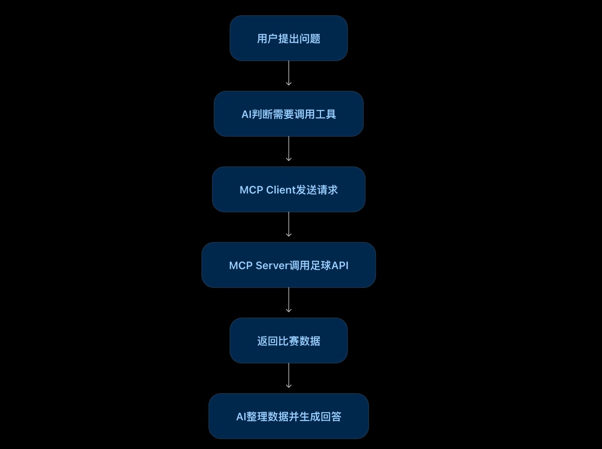

以前的AI，像一个读过很多书的高材生。你问它问题，它能侃侃而谈；但你让它查一下公司的订单、读取电脑里的文件，或者获取最新的足球比赛数据，它可能就两手一摊了。

不是它不聪明，而是它没有连接这些系统的通道。

怎么办？总不能让AI每次办事，都重新学习一遍怎么连接不同的软件吧？于是，MCP登场了！

## 一、MCP是什么？先把它理解成一套通用规则

MCP的全称是 Model Context Protocol，中文叫“模型上下文协议”。名字听起来有点唬人，其实可以把它理解成：**让AI按照统一规则连接外部工具和数据的一套标准。**

打个比方，假设你去国外旅游，不同国家的人说不同的语言。如果每去一个国家，你都得重新学一门语言，旅游还没开始，头发可能就先掉光了。

如果大家约定好一套通用的沟通规则，事情就简单多了。

MCP想解决的，就是AI连接各种外部系统时的类似问题。

比如，你正在开发一个足球网站，需要获取比赛赛程、球队资料和球员数据。以前，你可能要自己找API、研究接口文档、编写调用代码。现在，如果有合适的足球MCP Server，支持MCP的AI开发工具就可以通过它了解有哪些数据工具，并帮助你编写网站代码。

注意：MCP不是足球数据本身，也不是凭空变出数据的魔法。它提供的是一套标准化的连接方式，数据仍然来自背后的服务。

## 二、MCP Server：负责提供工具的“服务员”

MCP Server可以理解为一个工具服务站，负责把某些能力提供出来，让AI应用能够按照约定的方式使用。

例如，一个足球数据MCP Server可能提供这些能力：

- 查询今天有哪些足球比赛；
- 查询某支球队的资料；
- 获取联赛积分榜；
- 查询球员的比赛数据。

你可以把它想象成一家餐厅。

餐厅有菜单，菜单告诉你能点什么菜、每道菜需要提供什么信息。MCP Server也会以标准化的方式说明自己提供哪些工具，以及调用时需要什么参数。

你对AI说：“帮我查一下皇马下一场比赛。”

AI发现可以使用足球数据工具，就能发起调用。MCP Server收到请求后，再去获取相应数据并返回结果。

不过，Server不一定自己存着所有数据。它也可能只是一个中间服务，负责调用其他API、查询数据库，再把结果交回来。

**一句话：MCP Server负责把工具和数据能力提供出来，但不负责替你完成所有思考。**

## 三、MCP Client：负责连接服务的“接线员”

有了服务站，还得有人负责联系服务站，这就是MCP Client。

继续用餐厅举例：MCP Server是餐厅，提供菜单和菜品；MCP Client则像负责传递点单信息、接收上菜结果的服务人员。

它负责按照MCP协议连接Server、获取可用工具的信息、发送调用请求，并把返回结果交给AI应用继续处理。

例如，你使用一个支持MCP的AI编程工具开发足球网站。它连接足球MCP Server后，可以获取工具列表，再把相关能力提供给模型使用。模型判断需要查询比赛时，AI应用就能通过Client发起调用，拿到数据后继续编写代码或回答问题。

这里有个关键点：**你没有亲自编写MCP Client，不代表Client不存在。** 它可能已经集成在你使用的AI应用或开发框架中，就像你用浏览器访问网站，不需要自己先开发一个浏览器。

当然，如果你使用的工具不支持MCP，也没有其他兼容的客户端或适配层，就不能只给它一个MCP地址，指望它自动连接成功。

## 四、没有MCP，以前是怎么做的？

假设你要开发一个足球网站。

传统方式是：找到足球数据API，阅读文档，研究参数，编写调用代码，再处理返回的数据。如果之后还要接入天气、地图和球队新闻服务，你可能还得分别研究它们的接口。

有了MCP之后，如果这些服务提供了可用的MCP Server，而你的AI开发工具支持连接它们，AI就可以通过统一的协议了解和调用这些工具，减少重复的接入工作。

不过，MCP不会自动替你完成整个网站。页面设计、业务逻辑、数据展示、异常处理等工作，仍然需要AI根据需求生成代码，并经过开发者验证。

MCP也不会取代传统API。很多MCP Server的背后，依然是API、数据库或其他业务服务。

## 五、是不是一个MCP Client就能连接所有MCP Server？

理想情况下，是的：**一个支持MCP的客户端，可以连接多个兼容的MCP Server。** 这正是标准化的价值。

比如，你的AI助手可以连接足球数据Server获取比赛信息，连接文件Server读取文档，再连接GitHub Server查看代码仓库。

但这不代表所有客户端都能无条件连接所有Server。还需要考虑传输方式是否支持、认证方式是否兼容、网络是否可达，以及客户端有没有配置相应的权限。

更重要的是，能连接不等于能随意操作。查询数据和删除数据的风险完全不同，涉及真实业务时，仍然需要做好授权、权限控制和操作确认。

## 六、一次完整的MCP调用，到底经历了什么？

光知道 Server 和 Client 是什么还不够，我们用一个真实一点的场景，把整个过程走一遍。

假设你正在开发一个足球网站，想让AI帮你查询“皇马下一场比赛的时间”。你的AI开发工具已经连接了一个足球数据MCP Server。

**整个调用过程，可以分成六步：**

第一步：你提出需求。你对AI说：“帮我查询皇马下一场比赛的时间。”

第二步：AI查看可用工具。AI应用通过MCP Client连接足球数据MCP Server，获取它提供的工具列表，发现有一个工具可以查询球队赛程。

第三步：AI决定调用工具。模型判断，这个问题需要真实的比赛数据，于是决定调用赛程查询工具，并提供“皇马”这个参数。

第四步：Client发送请求。MCP Client按照MCP协议，把工具名称和参数发送给MCP Server。

第五步：Server查询数据并返回结果。MCP Server调用背后的足球数据API或数据库，获取比赛时间，再把结果返回给Client。

第六步：AI组织答案。AI应用把工具返回的数据交给模型，模型整理成自然语言，最终告诉你：“皇马下一场比赛将于某日某时进行。”具体时间以实际查询结果为准。

### 一张图看懂整个流程

用户提出问题 → AI判断需要什么工具 → MCP Client发送调用请求 → MCP Server获取数据 → 结果返回AI → AI生成最终答案。

这里最容易搞混的一点是：**不是AI直接跑到Server里执行代码，而是AI决定调用什么工具，Client负责协议通信，Server负责执行相应的工具逻辑。**

所以，MCP并没有取代AI，也没有取代API。它做的是把AI与外部工具之间的沟通方式标准化，让连接不同系统这件事变得更简单。

记住一个关键细节： MCP Client通常会先发现Server提供的工具；真正调用时，模型选择工具并生成参数，客户端再通过协议发起调用。工具结果回来后，AI才生成最终回复。不同AI应用内部的具体实现可能有所不同。

## 写在最后

记住这三个角色就够了：

**MCP是规则，MCP Client是连接工具的接线员，MCP Server是提供工具的服务站。**

MCP的价值，不是让AI突然变得无所不能，而是让AI能够用更统一的方式连接外部世界。

以前，我们主要是人打开软件、点击按钮、调用接口；现在，我们开始让AI理解需求，再通过工具去获取数据、执行任务。

当然，AI能不能把事情办好，还取决于模型能力、工具质量和权限设计。

但有一点已经很清楚：当AI不仅能聊天，还能连接真实业务系统时，它才真正开始从“会说话的助手”向“能干活的助手”迈进。
