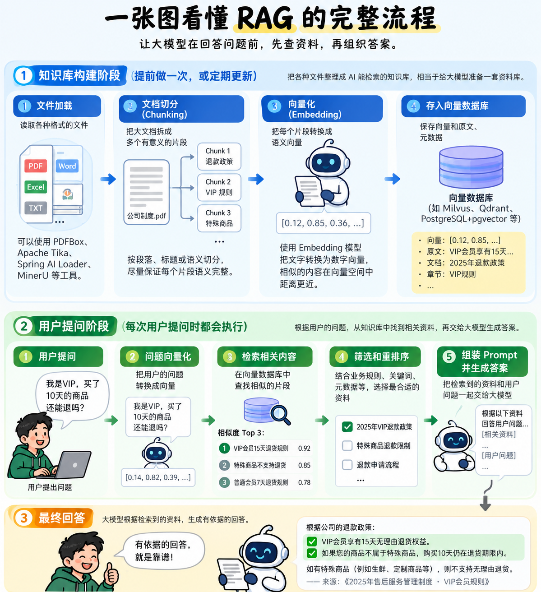

今天我们来聊一个AI应用开发中非常重要的技术——**RAG（检索增强生成）**。

名字听起来挺高大上，但它的核心思想其实很简单：**考试不会做？先翻书，找到相关资料，再组织语言回答。**

没错，RAG就是让大模型从“闭卷考试”变成“开卷考试”。

## 一、大模型这么聪明，为什么还需要RAG？

假设你开了一家公司，招聘了一位超级学霸当客服。

这位学霸上知天文，下知地理，能写代码、能写文章，甚至还能帮老板写年终总结。

结果上班第一天，客户就问：

“我是VIP会员，购买商品超过7天还能退款吗？”

学霸想了想，回答：“一般情况下，商品支持7天无理由退货，超过7天可能无法退款。”

老板听完差点血压飙升。

**公司明明规定VIP会员享有15天退货权益，你怎么能胡说八道？**

问题出在哪里？

不是学霸不聪明，而是他根本没看过公司的规章制度。

大模型也是一样。虽然它通过训练掌握了大量知识，但不代表它知道你公司的内部规定、最新业务数据。

更麻烦的是，有时候它明明不知道答案，却能一本正经地胡说八道，这就是我们常说的**AI幻觉**。

难道公司每修改一次退款政策，就要重新训练一次大模型？

当然不用！

我们只需要给它准备一本随时可以查阅的《公司业务手册》。

客户提问时，先查资料，再回答。

**这就是RAG存在的意义。**

## 二、RAG是什么？说白了就是给AI配个资料管理员

RAG的英文全称是 Retrieval-Augmented Generation，中文叫**检索增强生成**。

拆开理解：

- • Retrieval（检索）：查找相关资料。
- • Augmented（增强）：把资料提供给大模型。
- • Generation（生成）：根据资料组织答案。

所以，**RAG = 查资料 + 补充知识 + 生成答案。**

假设用户问：“我是VIP，买了10天的商品还能退吗？”

没有RAG，大模型可能凭自己的知识猜测。

有了RAG，系统会先找到公司规定：

“VIP会员享有15天无理由退货权益，特殊商品除外。”

然后大模型根据这条规则回答：

“如果您的商品不属于特殊商品，购买10天仍在退货期限内。”

是不是靠谱多了？

这里有个关键知识点：**RAG没有重新训练大模型，也没有修改模型参数。**

它只是把查到的资料临时放进本次对话的上下文中。

相当于给学霸发了一本参考书。

当然，开卷考试也不代表一定能考100分。翻错书、找错页，照样可能答错。

## 三、RAG是怎么工作的？

假设公司有10万份PDF、Word和Excel文档。

用户问一个问题，总不能把10万份文件全部塞给大模型吧？

那不是回答问题，那是让AI参加阅读马拉松。

所以，RAG需要提前建立一套方便检索的知识库。

整个流程其实可以分成两个阶段：

**第一阶段：建立知识库。**

首先读取PDF、Word等文件，然后把长文档切分成多个小片段（Chunking），再通过Embedding模型把文字转换成向量，最后保存到向量数据库中。

**第二阶段：用户提问。**

用户提出问题后，系统同样将问题转换成向量，再检索相关资料，经过必要的筛选和重排序，最后交给大模型生成答案。

听起来有点绕？

没关系，直接看下面这张图。

**👇 一张图看懂RAG的完整工作流程**

看完流程图，你只需要记住三个关键角色。

**① Chunking：负责切分文档。**

把一本厚厚的业务手册拆成许多有意义的小片段，方便后续检索。

但不能乱切！如果把“VIP支持15天退款”和“生鲜商品不支持退款”拆开，系统可能只找到前半句，结果回答错误。

**② Embedding：负责把文字变成向量。**

用户问“高级会员退货规则”，知识库写的是“VIP退款政策”。

虽然文字不同，但意思相近。

Embedding模型可以帮助系统找到这些语义相关的内容。

不过，它擅长理解语义相似性，不代表能精准判断所有年份、金额和业务条件。

**③ 向量数据库：负责保存和检索向量。**

例如 PostgreSQL + pgvector、Milvus、Qdrant 等。

用户提问时，系统通过向量相似度查找相关资料。

必要时，还可以结合关键词检索、元数据过滤和Reranking（重排序），进一步提高检索准确率。

注意：**Embedding模型负责生成向量，向量检索系统负责搜索，大模型负责生成回答。**

三个角色各司其职，千万别搞混。

## 四、RAG能做什么？为什么企业喜欢它？

RAG最大的价值，就是让AI能够利用企业内部知识和持续更新的外部资料。

例如：

**企业智能客服：** 客户询问退款、售后、产品使用方法，AI先查询公司规则，再回答。

**技术知识库：** 公司积累了大量接口文档、系统设计和技术方案，开发人员可以直接提问，让AI帮忙定位相关资料。

**个人知识助手：** 平时收藏了几百篇技术文章，半年后忘记某个知识点，AI可以从笔记中帮你找回来。

**产品说明书助手：** 把产品手册建立成知识库，用户不用翻几十页说明书，直接提问即可。

但RAG不是万能的。

例如，用户问：“我昨天的订单支付了多少钱？”

这种精确数据应该直接查询订单数据库，而不是通过向量相似度猜测。

**RAG擅长从大量资料中寻找相关知识，但不能代替所有数据库查询和业务API。**

## 五、RAG和微调有什么区别？

这也是一个很容易混淆的问题。

继续用学霸举例。

**RAG：给学霸一本新教材。**

学霸本人没有变化，只是在回答问题时可以查阅最新资料。

**Fine-tuning（微调）：给学霸进行专项培训。**

通过训练调整模型参数，让它更适应某类任务或输出要求。

所以，如果你想让AI知道公司最新的退款政策，通常优先考虑RAG。

如果你希望模型更稳定地完成某种特定任务，可以先尝试Prompt设计等方法，必要时再考虑微调。

两者并不冲突，也可以配合使用。

## 六、最后总结

学完RAG，我最大的感受是：

**真正有价值的AI应用，不一定要求模型什么都知道，而是要让它在需要的时候，能够找到正确的信息。**

这和我们做传统软件开发其实很像。

订单信息放数据库，业务规则由业务系统管理，商品资料通过接口获取。

大模型不需要把所有信息都记在脑子里。

它只需要在回答问题时，能够获取相关、准确、可信的资料。

所以，RAG的核心并不是Embedding，也不是向量数据库，而是：

**让正确的知识，在正确的时候，出现在大模型面前。**

以前的大模型：

“这个问题我好像知道，我猜一下……”

有了RAG的大模型：

“这个问题我先查查公司的最新规定。”

从“凭印象回答”，到“有依据地回答”，这就是RAG希望带来的改变。

当然，前提是它真的查对了资料。

**毕竟，开卷考试不可怕，可怕的是翻错了书，还答得特别自信。**

好了，今天的《从0学习AI》就聊到这里。

 