This tutorial is for learning about Cloudflare deployment, not for commercial use.

## Register with Cloudflare

Cloudflare is a well-known CDN provider with services such as reverse proxies, tunneling, and SSL. Its individual free plan covers the learning setup in this tutorial.

Workers and Pages are among its services. Here, we use Pages to deploy a VLESS node service.

Visit [Cloudflare](https://www.cloudflare-cn.com/plans/) and choose the free plan near the bottom of the page.

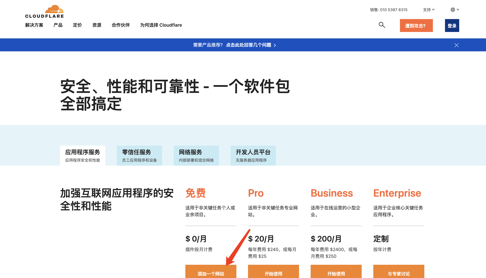

The registration process is straightforward. Remember to **verify your email**.

### Create a KV namespace

1. In your Cloudflare account, select **Storage & databases → Workers KV**, enter a namespace name, and click **Create**.

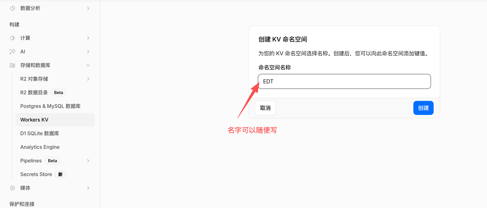

### Create a Pages application

1. Download the latest project ZIP: [edgetunnel-main.zip](https://github.com/cmliu/edgetunnel/archive/refs/heads/main.zip).
2. Select **Compute & AI → Workers & Pages → Create application**.

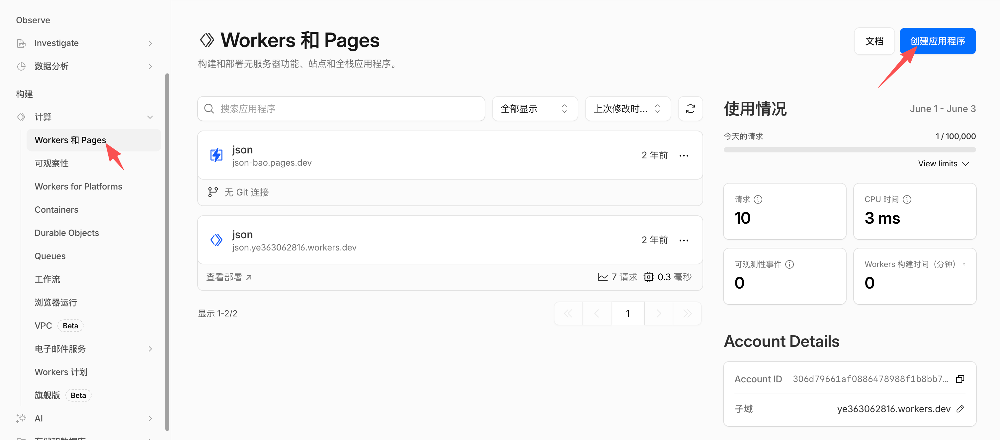

<ol start="3"><li>Click <strong>Get started</strong>.</li></ol>

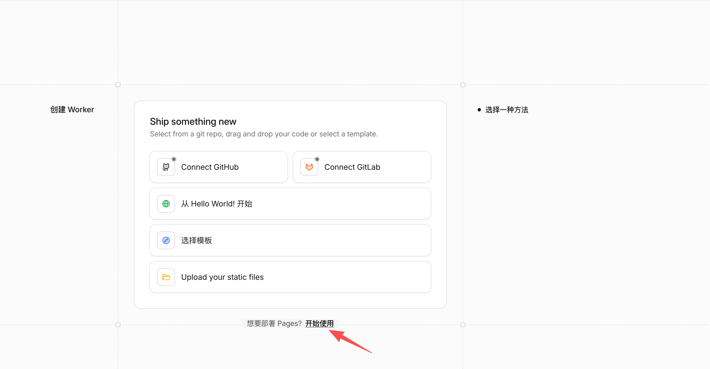

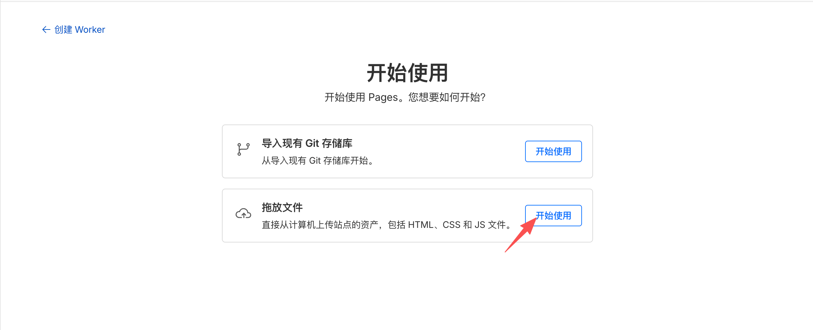

<ol start="4"><li>Enter a project name and click <strong>Create project</strong>.</li></ol>

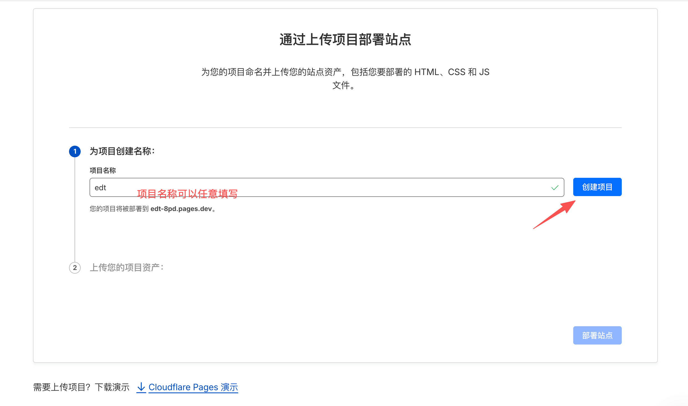

<ol start="5"><li>Upload the ZIP you downloaded, then click <strong>Deploy site</strong>.</li></ol>

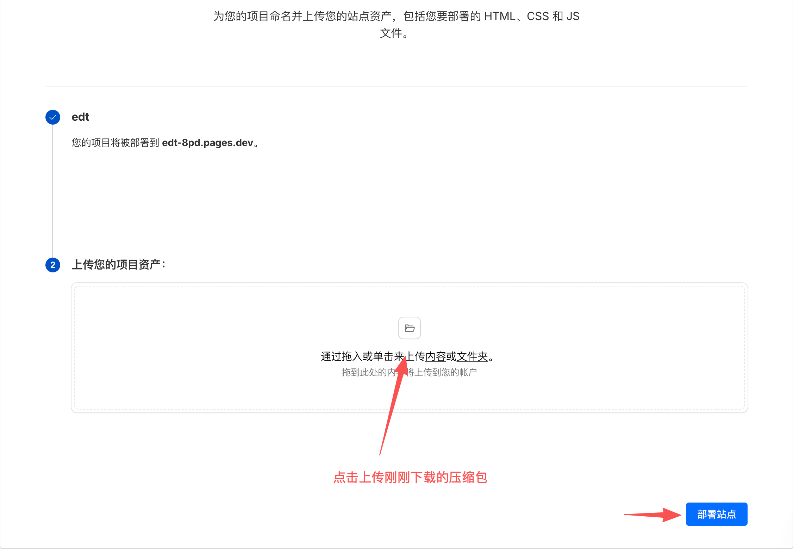

<ol start="6"><li>After deployment succeeds, click <strong>Continue to project</strong>.</li></ol>

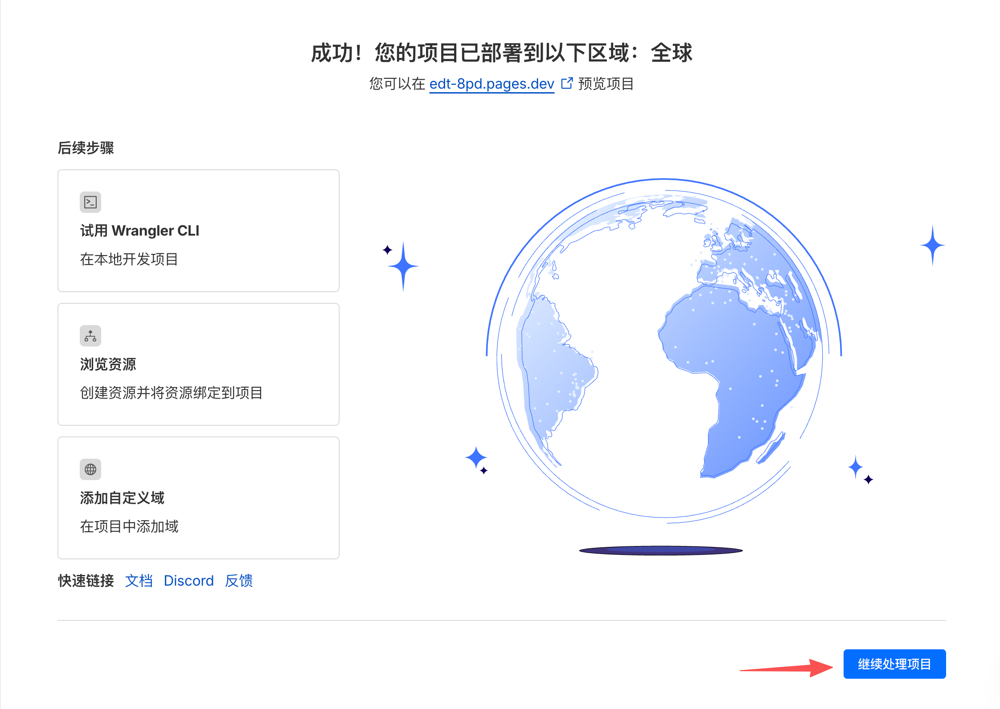

<ol start="7"><li>Open <strong>Settings → Variables and Secrets</strong> to add a variable.</li></ol>

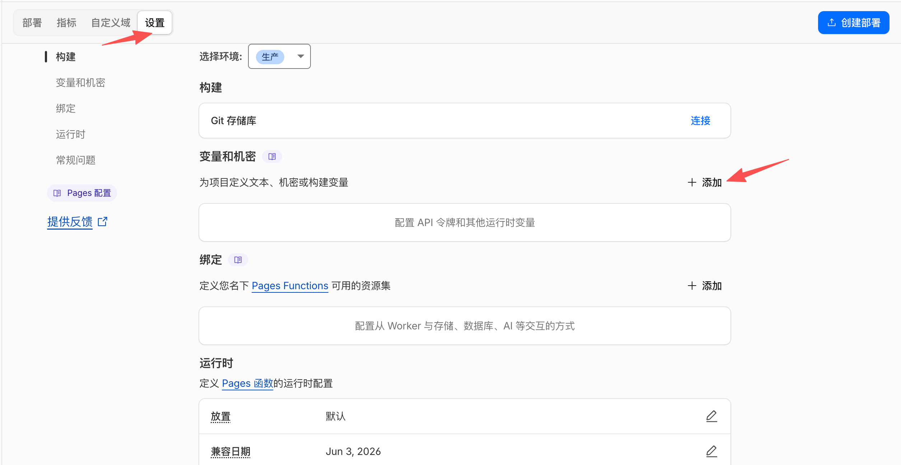

<ol start="8"><li>Add <code>ADMIN</code> and set its value to the administrator login password. Click <strong>Save</strong>.</li></ol>

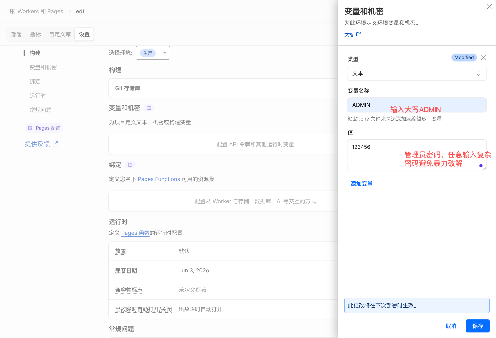

<ol start="9"><li>Bind the KV namespace created earlier. The binding's variable name must be uppercase <code>KV</code>.</li></ol>

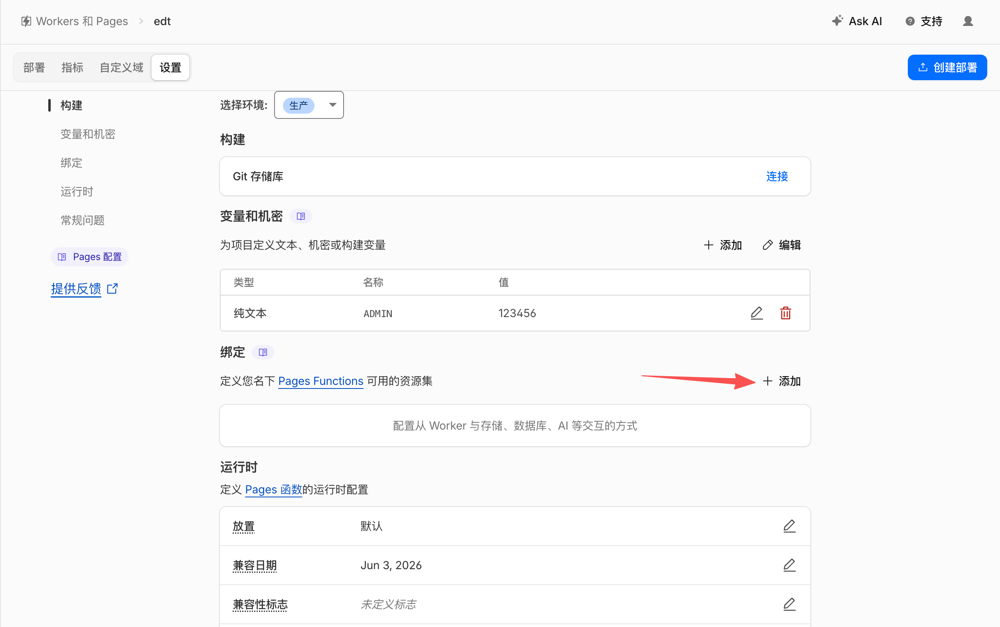

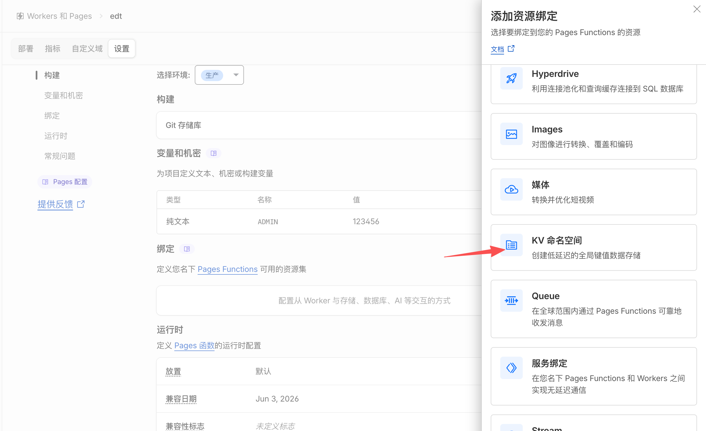

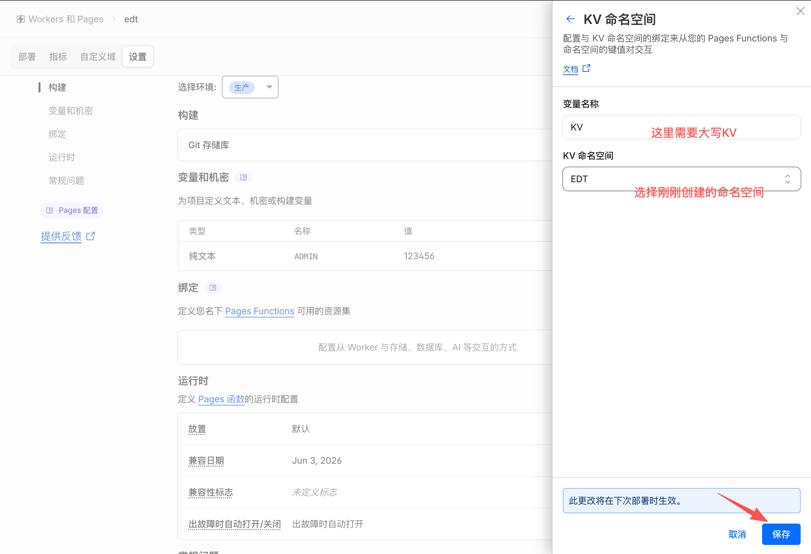

<ol start="10"><li>After saving, click <strong>Create deployment</strong>.</li></ol>

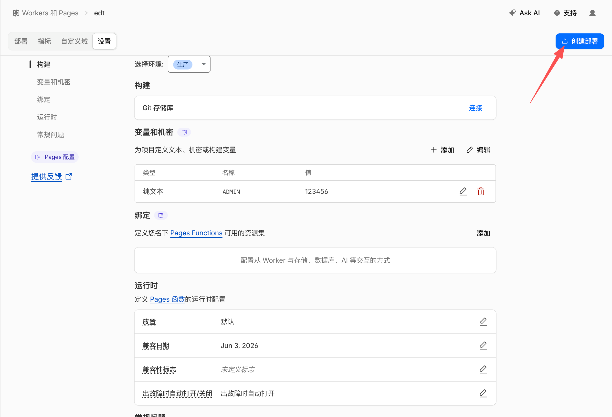

<ol start="11"><li>Upload the project again, then click <strong>Save and Deploy</strong>.</li></ol>

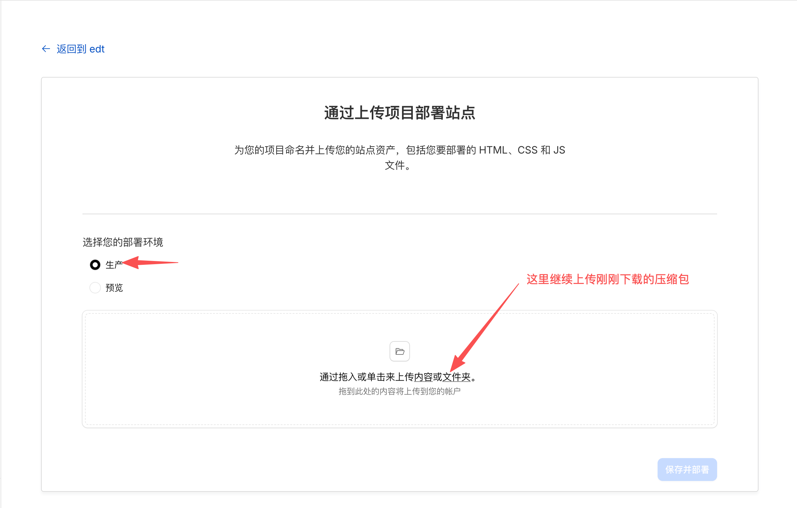

<ol start="12"><li>The success page confirms deployment and provides the production URL.</li></ol>

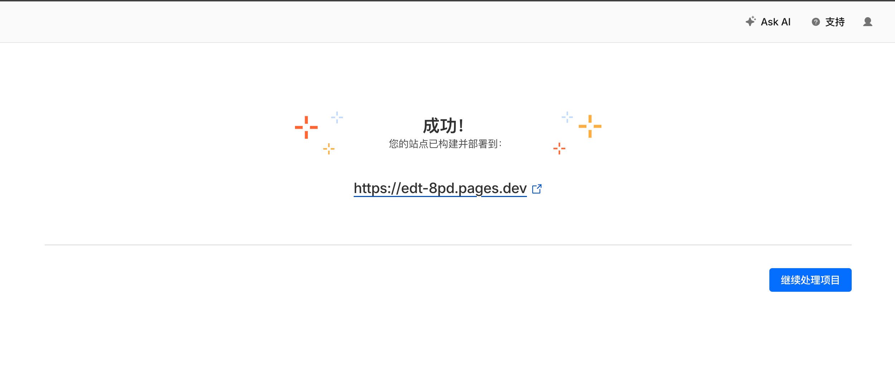

<ol start="13"><li>Open the deployed URL in a browser and append <code>/login</code>, for example <code>https://edt-8pd.pages.dev/login</code>. Sign in with the password you set in the variable.</li></ol>

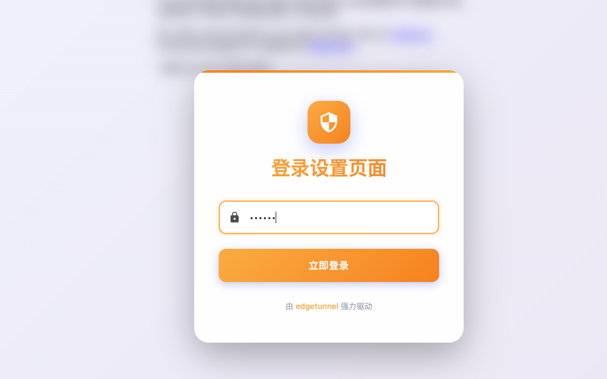

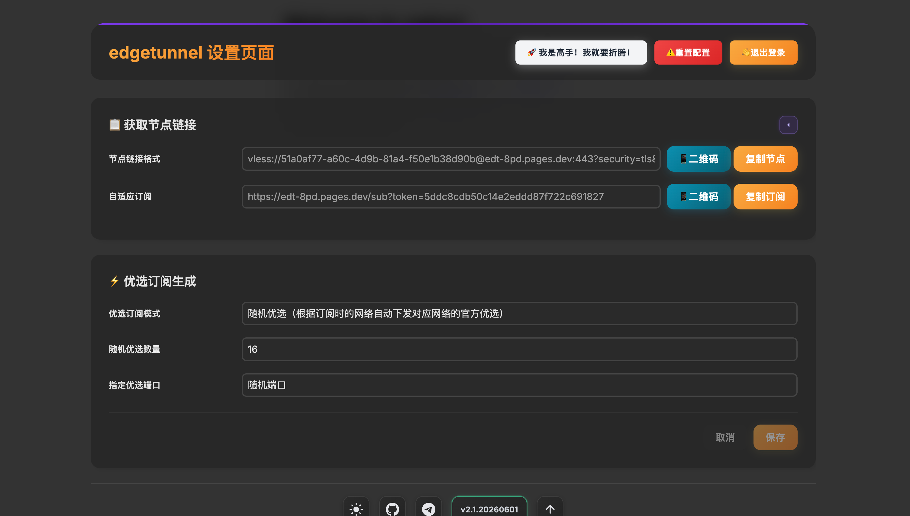

Congratulations, your own deployment is ready. Subscription setup is outside the scope of this walkthrough.

> Finally, do not share your account or connection links with others, or use them for profit. Doing so may violate criminal law and have serious consequences.
