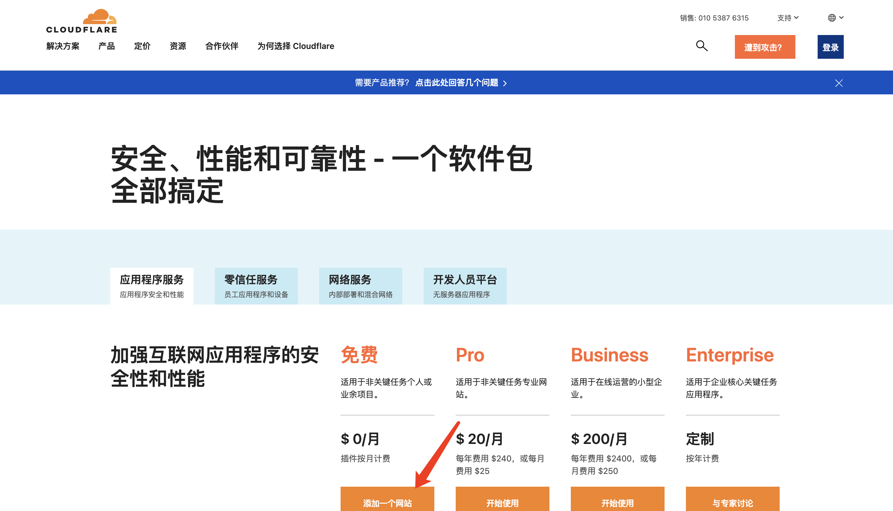
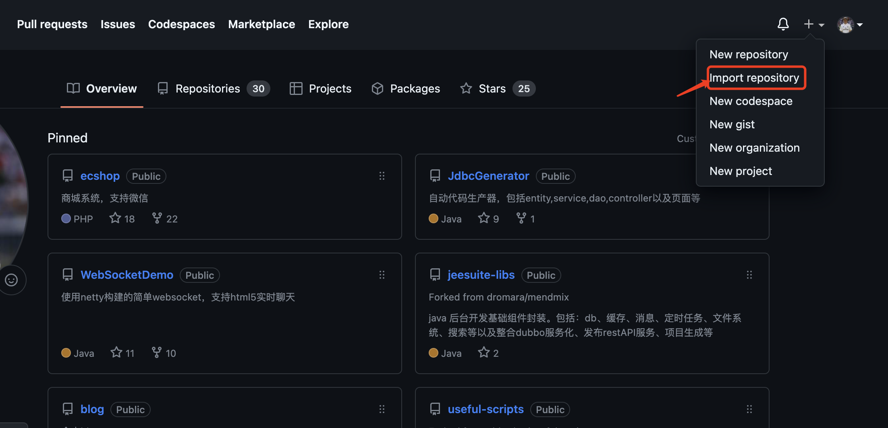
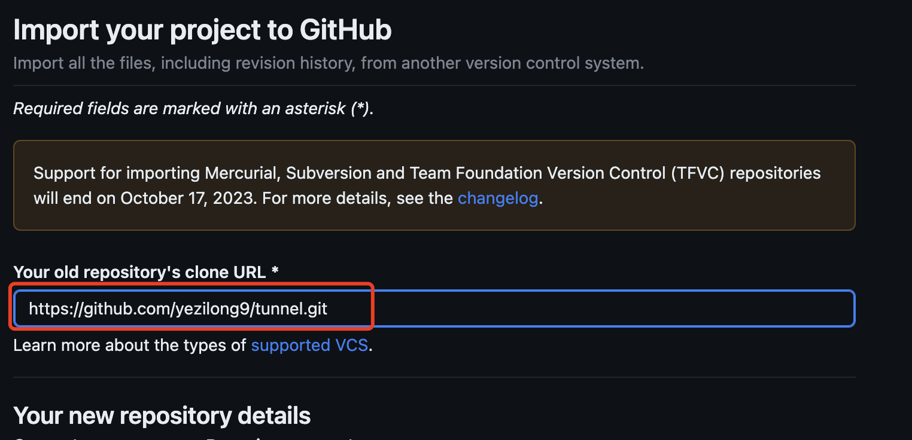
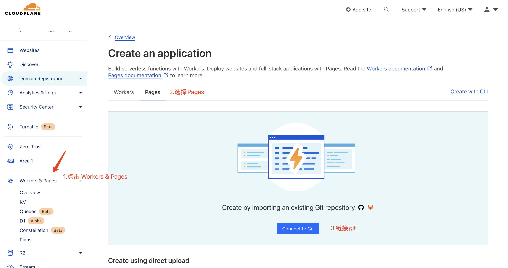
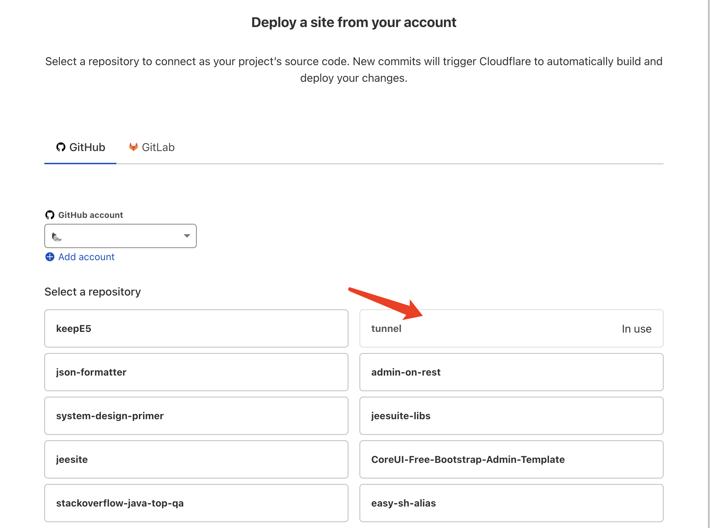
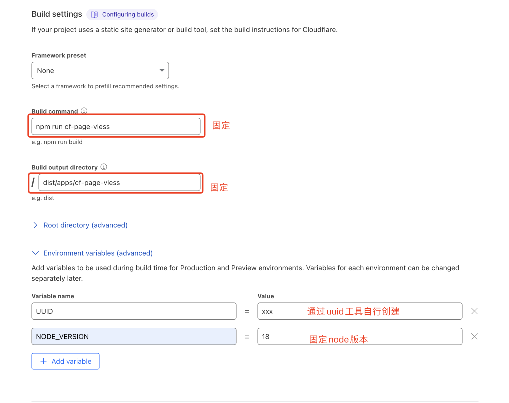
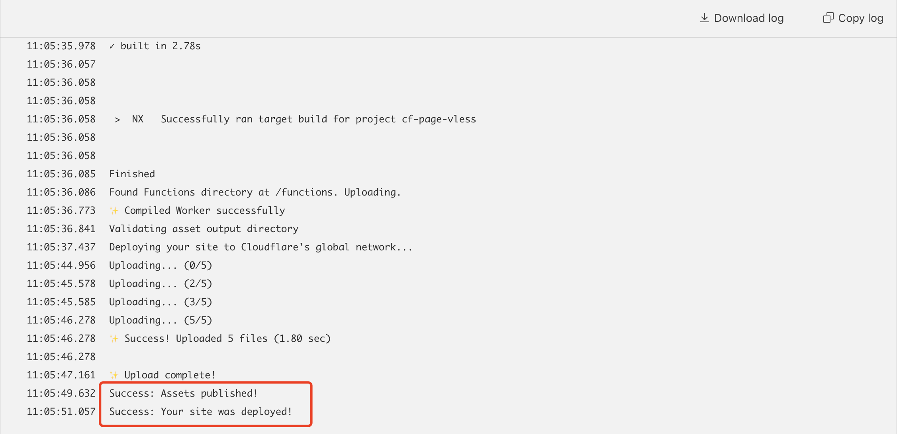
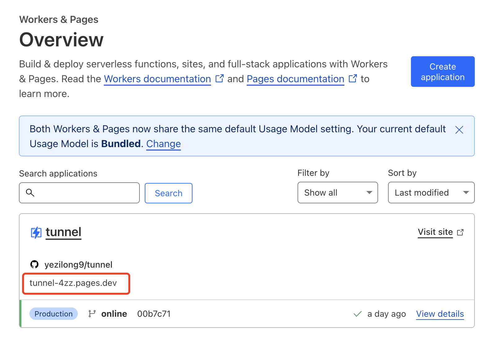
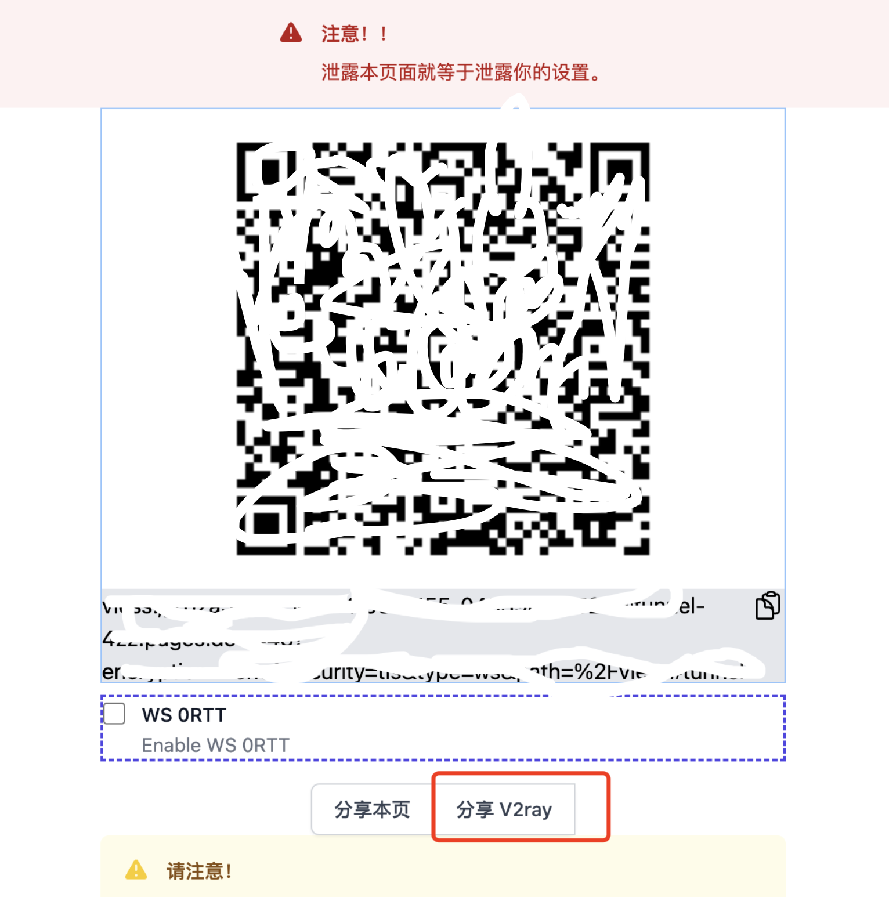

This tutorial is for learning about Cloudflare deployment, not for commercial use.

## Register with Cloudflare

Cloudflare is well known for its CDN, and also provides reverse proxies, tunneling, SSL, and other services that can improve a website. Its individual free plan was sufficient for the everyday learning use described here.

Among its services are Workers and Pages. Pages can deploy projects with capabilities beyond a simple static host. In this tutorial, we use it to deploy a VLESS node service.

Visit [Cloudflare](https://www.cloudflare-cn.com/plans/) and select the free plan near the bottom of the page.

Registration is straightforward, so I won't cover every step. Remember to **verify your email**.

## Import the project into GitHub

Sign in to GitHub and choose the option to import a repository.

Choose a name and enter this source repository URL: `https://github.com/yezilong9/tunnel.git`.

This is based on the open-source [edgetunnel](https://github.com/zizifn/edgetunnel) project.

Click **Begin import** to complete the import.

## Deploy from Cloudflare

Open the Cloudflare dashboard.

1. Select **Workers & Pages** in the sidebar.
2. Switch to the **Pages** tab.
3. Click **Connect to Git**.

<ol start="4"><li>Select the repository you just created.</li></ol>

<ol start="5">
<li>Enter a project name of your choice, preferably without protocol names such as xray, vmess, vless, ss, or trojan. Set <strong>Production branch</strong> to <strong>online</strong>. Remember to choose the <strong>online</strong> branch, or the application will fail to start.</li>
<li>Under <strong>Build settings</strong>, enter the following values.</li>
</ol>

| Setting | Value |
| --- | --- |
| Build command | `npm run cf-page-vless` |
| Build output directory | `dist/apps/cf-page-vless` |
| UUID | Generate one with a [UUID tool](https://1024tools.com/uuid) |
| NODE_VERSION | `18` |

Keep the UUID: it is used as the password for your connection.

<ol start="7"><li>Click <strong>Save and Deploy</strong>. Wait around three to five minutes for deployment to complete.</li></ol>

<ol start="8"><li>Return to Pages, copy the project's URL, and open it in a browser.</li></ol>

<ol start="9"><li>If the browser displays a username/password prompt, enter the generated UUID as the username. Use the V2ray sharing option to generate a VLESS connection link.</li></ol>

<ol start="10"><li>Save the connection link, open a VPN client on your phone that supports VLESS, and use the connection to access the internet.</li></ol>

That completes the deployment. On Cloudflare's free service, Workers and Pages together must not exceed 100,000 requests a day. I feel that is more than enough for looking up information and learning, as long as you are not watching videos.

## A final warning

Finally, do not share your account or connection links with others, or use them for profit. Doing so may violate criminal law and have serious consequences.
