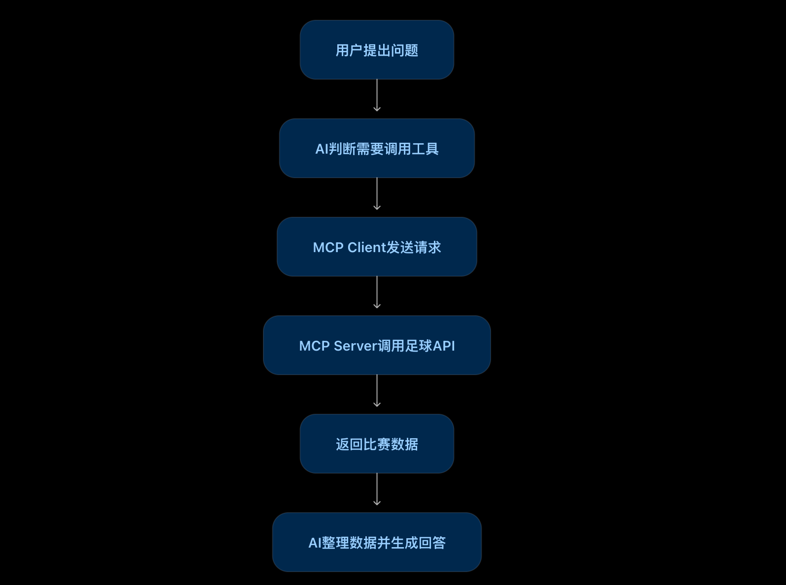

AI used to feel like a brilliant graduate who had read an enormous number of books. Ask a question, and it could talk at length. Ask it to check a company order, read a file on your computer, or fetch the latest football data, and it might shrug.

The problem was not a lack of intelligence. It had no connection to those systems.

Surely we should not have to teach every AI application a completely new way to connect to every piece of software. That is where **MCP** comes in.

## 1. What is MCP? Start with a shared set of rules

MCP stands for **Model Context Protocol**. Put simply, it is **a standard that lets AI applications connect to external tools and data in a consistent way**.

Imagine traveling abroad and needing to learn a new language in every country. You might lose all your hair before the holiday even starts. A shared set of communication rules would make things easier.

MCP addresses a similar problem when AI applications connect to different systems.

Suppose you are building a football website and need fixtures, team profiles, and player data. Traditionally, you would find an API, read its documentation, and write the integration. If a suitable football MCP server exists, a development tool that supports MCP can discover its data tools and use them while helping you build the site.

**MCP is not the football data itself, and it does not create data out of thin air.** It standardizes the connection. The data still comes from the service behind it.

## 2. MCP server: the service desk that provides tools

An MCP server makes capabilities available for an AI application to use according to the protocol.

A football data server might provide tools to:

- Find today's matches.
- Look up a team.
- Retrieve league standings.
- Query player statistics.

Think of a restaurant. Its menu tells you what you can order and which options you need to specify. An MCP server similarly describes the tools it offers and the arguments they accept.

You ask, "Find Real Madrid's next match." The AI application discovers a suitable tool and can request its use. The MCP server receives the request, obtains the data, and returns the result.

The server does not necessarily store all that data itself. It may call another API or query a database.

**In short: the server provides access to tools and data, but it does not do all the thinking for you.**

## 3. MCP client: the connector that talks to the service

A service desk still needs a connection. That is the role of the **MCP client**.

In the restaurant analogy, the server is the restaurant; the client is the part that passes along your order and brings back the result.

It connects to a server using the MCP protocol, discovers available tools, sends requests, and passes results back to the AI application.

For example, an AI coding tool connects to the football server, retrieves its tool list, and makes those capabilities available to the model. When the model decides it needs match information, the application can invoke the tool through the client, then continue writing code or answering your question.

An important detail: **not writing an MCP client yourself does not mean there is no client**. It may already be built into your AI application or framework, just as using a website does not require building your own browser.

Conversely, if a tool does not support MCP and has no compatible client or adapter, giving it an MCP address will not magically make it connect.

## 4. How did we do this before MCP?

For a football website, the traditional process was to find a data API, read the documentation, understand its parameters, write calls, and handle responses. Adding weather, maps, or news could mean learning another integration each time.

With MCP, compatible services expose a consistent protocol that supported AI tools can use to discover and invoke capabilities, reducing repetitive integration work.

But MCP does not automatically finish your website. Design, business logic, data presentation, and error handling still need implementation and verification.

It does not replace traditional APIs either. Many MCP servers still rely on APIs, databases, or business services behind the scenes.

## 5. Can one client connect to every MCP server?

The standardization goal is that **an MCP-capable application can connect to multiple compatible servers**: football data, local files, GitHub, and more.

That is not a promise of unconditional compatibility. Transport support, authentication, network connectivity, and permissions all matter.

More importantly, being able to connect is not permission to do anything. Reading data and deleting it have very different risks. Real business use still requires authorization, access controls, and confirmation for sensitive operations.

## 6. What happens during a complete tool call?

Let's walk through a realistic example. You are building a football site and ask an AI coding tool, already connected to a football MCP server, to find the time of Real Madrid's next match.

There are six steps:

1. **You make a request.** "Find the time of Real Madrid's next match."
2. **The application discovers tools.** Through the MCP client, it obtains the server's tool list and finds a fixture-query tool.
3. **The model chooses a tool.** It recognizes that real match data is needed and supplies the relevant team argument.
4. **The client sends the request.** The tool name and arguments go to the server using MCP.
5. **The server gets the data.** It calls its underlying football API or database, then returns the result.
6. **The model forms an answer.** The application provides the result to the model, which explains the match time in natural language. The actual time depends on the real query result.

### The whole flow at a glance

User request → model chooses a tool → MCP client sends the request → MCP server obtains data → result returns to the application → model answers.

**The model does not literally enter the server and run code.** It chooses a tool; the client handles protocol communication; the server implements the tool's behavior.

MCP therefore replaces neither the model nor the underlying API. It standardizes how the application connects the two.

Remember the sequence: discover tools, select a tool and generate arguments, send the request, receive the result, then generate the final response. Internal details vary between applications.

## Final thoughts

Remember these three roles:

**MCP is the rulebook. The MCP client is the connector. The MCP server provides the tools.**

The value is not making AI suddenly all-powerful. It is giving applications a more consistent way to connect AI to the outside world.

We used to open software, click buttons, and call APIs ourselves. Increasingly, we can express an intent and let an AI application use tools to retrieve information and carry out tasks.

Whether it does that well still depends on model capability, tool quality, and permission design. But connecting to real systems is a meaningful step from an assistant that can talk toward one that can help get work done.
