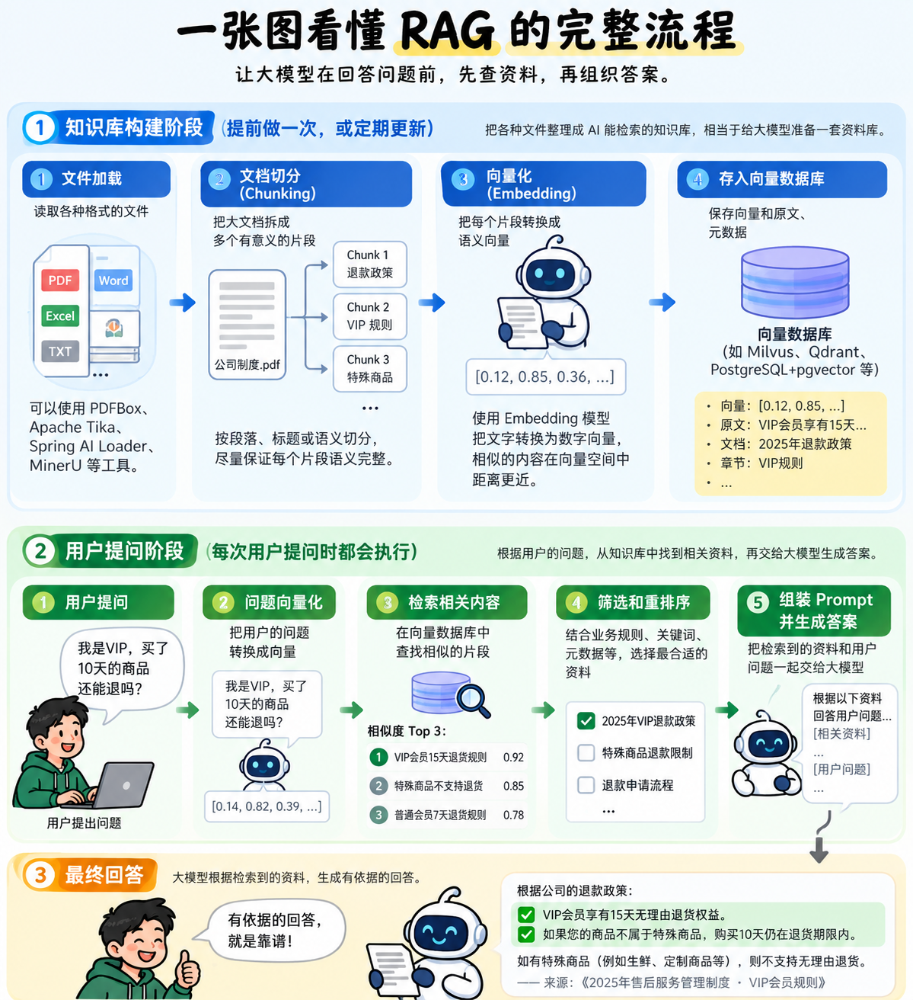

Today, let's talk about an important technique in AI application development: **RAG, or Retrieval-Augmented Generation**.

The name sounds grand, but the core idea is simple: **don't know an exam answer? Open the book, find relevant material, then explain it in your own words.**

RAG turns the model's closed-book exam into an open-book exam.

## 1. If language models are so smart, why do they need RAG?

Imagine hiring a brilliant graduate as a customer-support agent. They know science, write code, draft articles, and can even help the boss with an annual report.

On the first day, a customer asks:

> I'm a VIP member. Can I return a purchase after seven days?

The graduate thinks for a moment: "Usually, there is a seven-day return window. After that, a refund may not be possible."

The boss nearly explodes. **Our company gives VIP members fifteen days! Why are you making things up?**

The graduate is not unintelligent. They simply have never read the company's policies.

Language models face the same problem. Learning from vast amounts of training data does not mean knowing your company's internal rules or its latest business information.

Worse, a model may sound confident even when it does not know. That is the familiar problem of **AI hallucination**.

Do we have to retrain the model whenever the refund policy changes? No. We can provide an up-to-date business handbook and retrieve the relevant material before answering.

**That is why RAG exists.**

## 2. RAG is like giving AI a research assistant

Break the term down:

- **Retrieval:** find relevant information.
- **Augmented:** give that information to the model.
- **Generation:** use it to formulate a response.

So: **RAG = look things up + provide context + generate an answer.**

A user asks, "I'm a VIP. Can I return something I bought ten days ago?"

Without RAG, the model may guess from general knowledge. With RAG, the system first retrieves the policy:

> VIP members have a fifteen-day no-questions-asked return window, excluding special product categories.

The model can then explain: "If your purchase is not in an excluded category, ten days is still within the return period."

An important point: **RAG does not retrain the model or change its parameters.** It temporarily adds retrieved information to the context for this request.

It is like handing the graduate a reference book. Of course, an open-book exam does not guarantee a perfect score. Open the wrong book or find the wrong page, and you can still get the answer wrong.

## 3. How does RAG work?

Suppose the company has 100,000 PDF, Word, and Excel documents. We cannot reasonably send all of them to the model for every question. That would be a reading marathon, not a support request.

RAG therefore builds a searchable knowledge base in advance. The process has two stages.

**Stage one: prepare the knowledge base.** Read the documents, split long documents into meaningful chunks, turn text into vectors with an embedding model, and store those vectors in a searchable database.

**Stage two: answer a question.** Encode the question, retrieve related material, filter or rerank it when needed, and pass the selected context to the language model to generate a response.

Here is the overall workflow:

The diagram has three key roles.

**1. Chunking: divide documents into useful pieces.**

Split a thick business handbook into smaller, meaningful sections that can be retrieved.

But don't cut blindly. If "VIP members can return items within fifteen days" is separated from "fresh food is excluded", retrieval may find only half the rule and produce a wrong answer.

**2. Embeddings: represent text as vectors.**

A user may ask about "premium member returns" while the document says "VIP refund policy". The wording differs, but the meanings are related.

An embedding model helps the system find this semantic relationship. That does not mean it can reliably distinguish every year, monetary amount, or business condition without other checks.

**3. A vector database: store and retrieve vectors.**

Examples include PostgreSQL with pgvector, Milvus, and Qdrant.

The system can retrieve related material using vector similarity. Keyword search, metadata filters, and reranking can also help improve accuracy.

Keep the responsibilities clear: **the embedding model creates vectors; the retrieval system searches; the language model generates the answer.**

## 4. What can RAG do, and why do businesses use it?

Its main value is letting AI use internal knowledge and external material that changes over time.

**Customer support:** retrieve company rules before answering questions about refunds, after-sales service, or product use.

**Technical knowledge bases:** help developers locate API documentation, system designs, and accumulated engineering decisions.

**Personal knowledge assistants:** find an idea in hundreds of saved technical articles after you have forgotten where you saw it.

**Product-manual assistants:** answer a user's question without making them search through dozens of pages.

But RAG is not a universal solution. If someone asks, "How much did I pay for yesterday's order?", the system should query the order database or a suitable API. It should not guess an exact payment amount from vector similarity.

**RAG finds relevant knowledge in documents. It does not replace every database query or business API.**

## 5. How is RAG different from fine-tuning?

Return to our brilliant graduate.

**RAG gives them a new textbook.** The person stays the same, but can consult current information while answering.

**Fine-tuning gives them specialized training.** It changes the model's parameters to adapt behavior to particular tasks or output requirements.

If you want the AI to know the latest refund policy, RAG is usually the first approach to consider. If you need more consistent performance on a specific task, start with approaches such as prompt design, then consider fine-tuning where appropriate.

These techniques are not mutually exclusive; they can work together.

## 6. Final thoughts

The biggest lesson for me is this:

**A valuable AI application does not have to make the model know everything. It has to help the model find the right information when it needs it.**

That is not so different from traditional software. Orders live in databases, business rules are managed by business systems, and product information comes from services.

The model does not need to memorize all of it. It needs relevant, accurate, trustworthy material at the moment it answers.

The heart of RAG is therefore not just an embedding model or a vector database. It is **putting the right knowledge in front of the model at the right time**.

Before RAG: "I think I remember this. Let me guess."

With RAG: "Let me check the latest company policy first."

The goal is to move from answering by impression to answering with evidence, provided the retrieval actually found the right evidence.

After all, an open-book exam is not the scary part. The scary part is opening the wrong book and answering with complete confidence.

That's it for today's installment of learning AI from the ground up.
